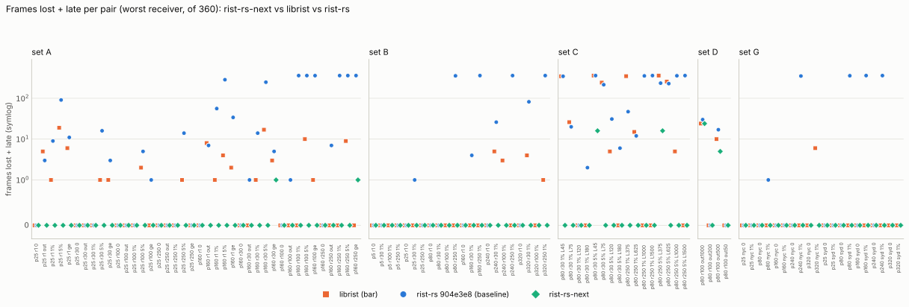
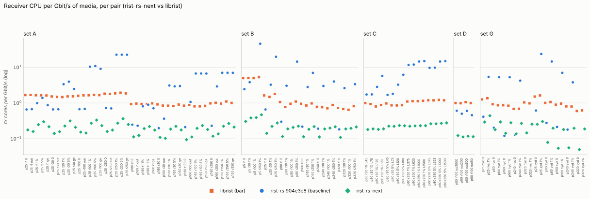
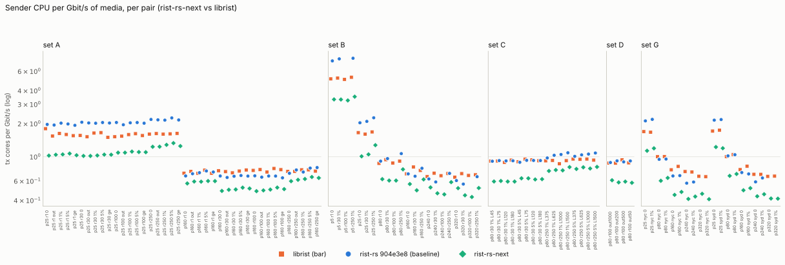
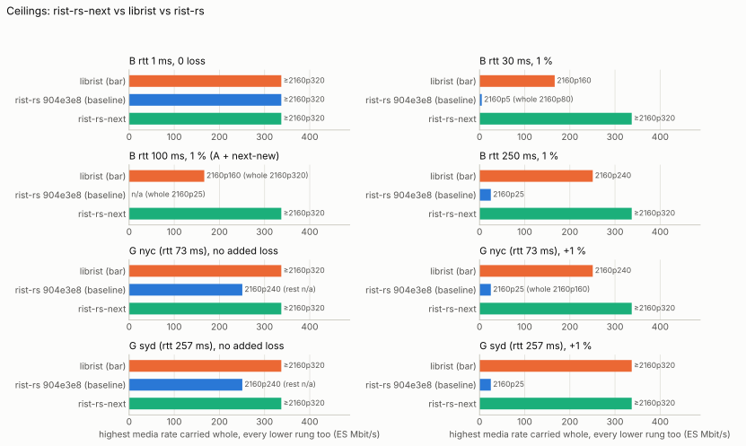
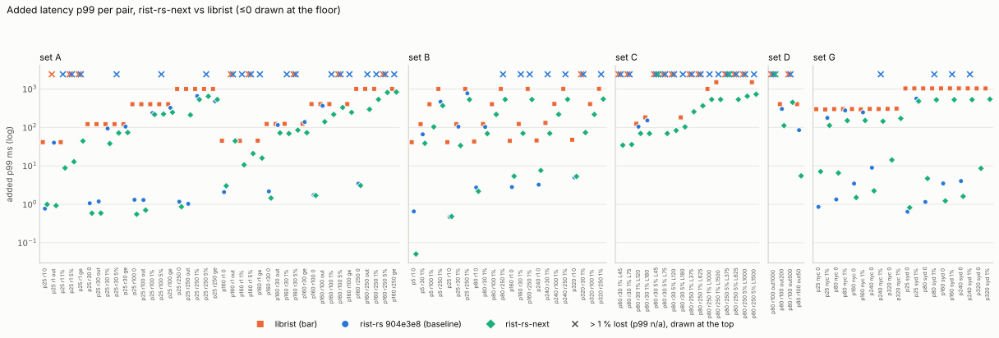
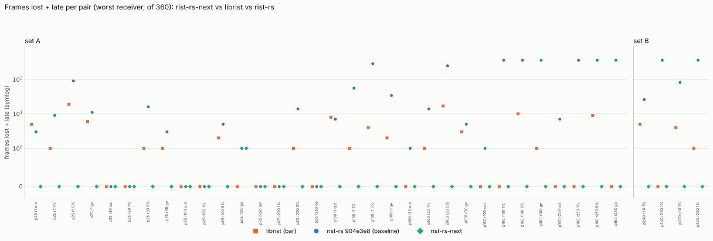

# rist-rs against librist 0.2.20 on the transport bench

26 November 2026. The new rist-rs (`rist-rs-next`: branch `perf-librist-parity`) ran twice on
fresh dedicated Linode hosts against the existing librist and rist-rs baseline from
24 November (`tbench-linode-20261124`). The baseline was not re-run.

- **Run b** (`trist-linode-20261126b`, rist-rs head `cbf19d8`, clean build): the verdict run.
  178 cases, plus repeats in `-rep` (6 cases) and `-rep2` (3 cases).
- **Run a** (`trist-linode-20261126a`, rist-rs `82bfc2b`): the first run, 178 cases plus
  `-rep` (9) and `-rep2` (1). It is shown beside run b throughout.

The only rist-rs change between the two runs is the start-of-stream fix (`cbf19d8`, below).
Raw data is in the R2 bucket `needletail-data` (`trist-linode-*`, `trist-local-*`,
`tbench-linode-20261124`). The bench's own tables are in
[`run-b/summary.md`](run-b/summary.md) (run b) and [`run-a/summary.md`](run-a/summary.md) (run a). Run a
and run b per pair side by side: [`run-b/runs-a-b.csv`](run-b/runs-a-b.csv). How it was measured
and its limits, in short: [README.md](README.md).

## TL;DR

rist-rs-next at `cbf19d8` meets the goal set for this work on five of the six
criteria outright in run b. The frames-lost criterion has one 1-frame miss, in a different
cell from run a's miss. That frame was lost mid-stream, not at the start, and both repeats of
the cell lost 0. Over the two runs, 100 of 102 pairs were at or below librist both times. The
other 2 pairs each missed by 1 frame in one run, and every repeat of them lost 0.

The start-of-stream fix works: frame 0 reached every receiver of every case in run b, except 2
of the 100 receivers in the fan-out-100 case that fails for every transport. The four E jitter
cells went from 1–2 frames lost to 0.

| criterion (brief) | run b, rist-rs `cbf19d8` (verdict) | run a, rist-rs `82bfc2b` | worst case in run b |
|---|---|---|---|
| Frames lost ≤ librist in every T8 case (94 + 8 new pairs) | **pass with one 1-frame miss (noise level)**: 101 of 102; 102 of 102 if a repeat counts | 101 of 102 (miss: A 2160p25 RTT 250 GE, frame 0) | `A lon 2160p160 rtt250 ge`: 1 frame (frame 18, mid-stream) against librist's 0. Both repeats and run a lost 0. Over all 102 pairs, rist-rs-next lost or delivered late 63 frames and librist 2 111. Old rist-rs lost 8 927 over 94 pairs. |
| Sender and receiver CPU per Gbit/s ≤ librist (clean, 1 %, 5 %, burst) | **pass**, 102 of 102 on both sides | 102 of 102 | Highest tx ratio 0.87 (C RTT 250, L 4× and 6×). Highest rx ratio 0.39 (nyc 2160p240 +1 %; the nyc host received slower in this run). Median tx 0.66–0.71×, rx 0.11–0.23× librist. |
| Highest rate carried whole ≥ librist (B and next-new, RTT 1/30/100/250, nyc, syd) | **pass**, 8 of 8 conditions | 8 of 8 | rist-rs-next carried every rung up to 2160p320 (334 Mbit/s ES) whole in every condition, in both runs. librist's ceilings range from 2160p160 to ≥ 2160p320. |
| Added latency ≤ librist | **pass**, 102 of 102 (p99) | 102 of 102 | Smallest margin at RTT 1 ms: 16 against 45 ms (2160p160 GE). In A 2160p25 RTT 1 GE, 5 frames took 46–47 ms (p99 44 ms); librist lost 6 frames there. |
| Interoperates with librist both ways | **pass**: works 44 of 44, ≤ the worse native in 44 of 44, worse than both natives in 0 | works 44 of 44; 3 cells worse than both natives | 4 cells are 1–2 frames above native rist-rs-next but below native librist (RTT 100 at 5 %, 2160p320 RTT 30 at 1 %). librist→next A 2160p25 RTT 250 1 % lost 0 (run a: 1, frame 0). |
| Product settings, not a tuned profile | **pass** | pass | rist-rs-next ran with the product defaults (see Method). Unlike librist, it did not get the path RTT as `rtt_min`. The product branches now pin `cbf19d8` and set the same startup hold (web-services `49c629a`, av-contrib `14872d1`). |

Every case where rist-rs-next is behind librist on any measure, in either run, is listed under
[Remaining gaps](#remaining-gaps-and-what-would-close-them).

## What changed in rist-rs (904e3e8 → 82bfc2b → cbf19d8)

The IDs follow the fix plan (`docs/rist/transport-rist-plan.md` §1 on the transport-bench branch `rist`). Commits are in
`git log --oneline 904e3e8..cbf19d8` in this repository.

**Receiver, recovery (P1, P4, P2, P5, P6, P7)**
- P1 + P4 `2845937`: `MissingTracker` rewritten as a hole FIFO with a NACK schedule. It does O(open holes) work instead of scanning every slot per packet, and it never overwrites a hole silently. This removed the receiver CPU collapse (old rist-rs used 3–22 cores/Gbit under loss).
- P2 `1410042`, `3fe6d28`, `45d8a63`: NACKs are sent when due at the 1 ms poll. The receiver measures RTT itself (echo and Karn samples) and re-NACKs at 1.1 × RTT, with a per-attempt repeat policy and backoff.
- P5 `ab3ab34`, `90be96a`, `0ca770f`, `be47529`, `1d336fc`, `0ca94d2`: NACKs are split into MTU-sized packets, oldest first, and only what was sent is counted. New refusal and NACK counters.
- P6 `b047654`, `7210f91`: `OrderedPayloadBuffer` is O(log n) on extended keys. It drops late packets, skips holes at the deadline, and resyncs after a backward jump.
- P7 `e4abed3`, `7b552c2`, `2f8524e`: retransmissions carry the SSRC retry bit, and receivers clear it.
- Sequence reading `170228a`, `e0d5248`, `83d5157`, `532dec2`: sequences are extended near the highest seen. A repair is never read forward. A far-behind repair is read behind. The duplicate ring is sized by the observed rate.

**Sender (P3, P8, S1, S3)**
- P3 `35e7af1`, `f4dee95`, `532dec2`: repair age is judged by send time, and history is kept by time. `532dec2` returned to the newest-sent age rule.
- P8 `12c5b99`, `1c59eb4`: senders answer echo requests and smooth their RTT.
- S1 `ce3d232`, `fe9ee3d`: each packet is encoded once into its history slot and sent with one `sendmsg` from the history on a connected socket.
- S3 `5ea7ee3`, `804c263`: mio senders are sources with `service()` and send-driven timers. There is no busy spin during SRP re-auth, and keepalives are opt-in.
- S2 (`sendmmsg`) was not done. S1 and S3 alone brought tx CPU below librist's.

**Beyond parity (B1–B4)**
- B1 `f0cde4f`: adaptive first-NACK delay.
- B2 `ed4127d`, `865dc2d`, `c576b80`: every NACK attempt is sent twice, with the copy gap kept under the sender's spacing. The first repair ends the backoff.
- B3 `390b7e9`: late repairs are sent twice. The sender has deadlines.
- B4 `bd5685c`, `95ba3d4`: a tail-loss probe from the gap inside a burst.

**Interop and product (P9 and others)**
- P9 `26b90d6`, `62ffb99`: a bound Simple receiver NACKs from its socket, so a lossy librist Simple sender is repaired.
- `a974bc5`, `2dfe7b9`: interop tests. A rist-rs sender repairs a librist receiver, and the echo works both ways in Main and Simple.
- `7c85c2d`: the Main receiver has per-peer keepalive and idle eviction. `eabef30` parses clear data packets in place (one copy).
- `f22ace4`: a connected socket treats ICMP errors reported for an earlier datagram as a drop.

**Fix-loop rounds after the local runs**
- Round 1, `83d5157`: late duplicate repairs were read forward as a 32 767-packet jump, which caused phantom-hole storms at 160–337 Mbit/s locally. This round also makes the sender send the first data packet twice, adds a startup hold option, and serves feedback inline every 32 packets.
- Round 2, `532dec2`: the review of round 1. A repair more than 2^15 behind is read behind, the sender returns to the newest-sent age rule, and a forward jump clears the rate marks.
- Round 3, `82bfc2b` (run a): senders send every due repair. Before, about 9 600 of 23 129 counted repairs were dropped on WouldBlock in the RTT 1 outage case. A lost tail is probed again (three times at most), and the receiver re-NACKs after a batch drains.
- **Round 4, `cbf19d8` (run b): the start of a stream is recovered like the middle, by default.** Run a lost frame 0 in seven cells, because nothing before the first packet seen could be NACKed or delivered. Now, in `RecoveryTuning::default()` (the product tuning):
  - The sender sends its first packet again at +1 ms (`duplicate_gap`) and once more at +12 ms (new `first_packet_late_copy`), retry-marked, so one burst cannot take every copy.
  - For the first 25 ms (`DEFAULT_STARTUP_HOLD`, at most L), the receiver takes a packet up to 1 024 below the first one seen as the new start and NACKs the sequences in between. A first sequence of 1..16 is taken as a stream numbered from 0, so a lost first packet of a librist sender is NACKed too.
  - `OrderedPayloadBuffer::with_deadline` holds the first payload for that time by default, takes packets below it instead of dropping them as late, and ends the hold early when the sender's copy of the first packet arrives. After the hold, gaps are ordinary gaps, so the steady state is unchanged.
  - New counters: `startup_holes`, `startup_packets`, `ordered_startup_holds`, `ordered_startup_timeouts`, `ordered_startup_rebased`, `ordered_zero_starts`.
  - Tests: `rist-core/tests/startup_sim.rs` (bursts of 1–8 first packets at RTT 1/30/100/250, 5 ms jitter, a librist-like sender losing its first 1/3/8 packets, steady state unchanged) fails on 82bfc2b and passes on cbf19d8. A librist interop test drops a librist Main sender's first 1 and 3 packets, and the stream is delivered whole and in order.
- Tools: `b70653a`, `9c02edf` (a deterministic recovery simulation with jitter and reordering) and `9b1fd85`, `a3b4886` (benchmarks and a loopback end-to-end test).

At 82bfc2b: 215 rist-core and 72 rist-mio tests pass, and librist 0.2.20 interop passes 26 of 26.

The harness adapter now takes the startup hold from the library instead of its own formula
(transport-bench `rist` `102779b`), and pushes duplicates into the buffer as the product does.

## Method

- **Baseline not re-run.** librist, rist-rs (904e3e8) and rist-rs-614 come from
  the bench's `results/cases.csv` (run `tbench-linode-20261124`, 972 cases; its librist, rist-rs
  and udp rows are in [`baseline-20261124/cases.csv`](baseline-20261124/cases.csv)). The new matrices
  (`lab/matrices/next-*.json` on the transport-bench branch `rist`, from `python3 lab/matrix.py next`) contain only:
  - rist-rs-next;
  - 16 udp references;
  - 44 interop cases;
  - the 8 librist cells of `next-new`, which the baseline does not have: RTT 100 at 1 % for 2160p5/80/240/320, and 2160p320 on nyc/syd. These ran in both runs, so each run is compared with its own librist for these 8 cells.

  Case ids match the baseline's 1:1, with `librist` replaced by `rist-rs-next`.
- **Product settings.** rist-rs-next ran with:
  - bandwidth 100 000 kbit/s;
  - `rtt_min` 5 ms, whatever the path's RTT;
  - `rtt_max` 500 ms, reorder 15, retries 6..20;
  - `RecoveryTuning::default()`;
  - buffer L from the matrix (the same L as librist: max(4 × RTT, 40 ms), or the C/D values);
  - delivery through `OrderedPayloadBuffer::with_deadline(cap, L)`. In run b this carries the library's default startup hold (25 ms, at most L). In run a the adapter set `duplicate_gap` + 4 ms.

  The adapter drives the library as a product caller would (`src/proto/rist_rs_next.rs` on the transport-bench branch `rist`).
  librist got `buffer-min=max=L`, `rtt-min` set to the **path RTT**, reorder 15 and retries
  6/20 (`docs/rist/understand-harness.md` §1.3 on the transport-bench branch `rist`). librist therefore had a hint that
  rist-rs-next did not get.
- **Labs.** Both used image `linode/arch` and the same host types as the baseline:
  - lon-tx and lon-rx: g6-dedicated-16 in gb-lon, on different physical hosts, linked by a private VLAN (netem paths);
  - new-rx (us-east) and syd-rx (ap-southeast): g6-dedicated-8.

  The sender is always lon-tx. Memory on every node was warmed before measuring, and 3
  throw-away cases ran first (`-warm`, all ok).

  | | run a | run b |
  |---|---|---|
  | lab | `tr1126a` | `tr1126b` |
  | rist-rs | `82bfc2b` | `cbf19d8` (clean; every summary carries `cbf19d85518a`) |
  | harness / `tb` | `8b5d493` | `3057c8f`, `tb` built at `102779b` (sha256 `f4d95ab3…`, the same binary as the local r3 runs) |
  | up, down (UTC) | 02:31, 04:46:05 | 08:31:07, 10:47:09 |
  | main run | 178 cases | 178 cases, 08:58–10:41; repeats 10:41–10:47 |
  | status | 177 ok, 1 transport_failed | 177 ok, 1 transport_failed, 0 failed |
  | steal | none flagged (highest sample 13.3 % before a retry) | none flagged (3 cases waited 30 s once, at 2.3–4.0 %) |

  The transport_failed case is the same in both runs: `F … fo100` at 2160p25 (2.6 Gbit/s from
  one sender; librist and old rist-rs failed it too). Both runs' repeats were all ok.

  Run b's prep stalled for 10 minutes on stale SSH host keys for recycled addresses, and its
  memory warm-up was slower than run a's (124 s and 256 s on the London nodes, against 19 s).
  Neither affects a measurement; both are in the run's `notes.txt`.
- **Cases.** Each case runs 15 s at 24 fps, so 360 frames.
- **Repeats.** Each run's `-rep` re-ran the next-t8 cases with lost + late above zero (run a
  also the F fo100 case). Run a's `-rep2` re-ran the RTT 1 outage cell. Run b's `-rep2` re-ran
  A 2160p25 RTT 250 GE (run a's miss) and the two A GE cells that lost a frame. The tables use
  each run's **first** result; repeats are shown beside it.
- **RTT pinning.** The baseline's `path_rtt.json` (nyc 73 ms, syd 257 ms) was copied in
  before set G in both runs, so G cases have the same RTT and L as the baseline. Measured from
  lon-tx (`path-ping.txt`, 20 pings):

  | receiver | run a | run b | baseline |
  |---|---:|---:|---:|
  | nyc | 71.9 ms | 66.7 ms | 72.1 ms |
  | syd | 248.4 ms | 246.2 ms | 257.0 ms |

  The real routes were 5–11 ms shorter in run b. This gives rist-rs-next a few ms less one-way
  delay on G, which is far too small to change any G verdict: every G latency margin is
  hundreds of ms, and rist-rs-next lost no G frame in either run.
- **Bases and deadlines.** Added latency and late-lost use each run's own udp references
  (next-ref). Every row of both runs has a base from a udp envelope (`base_source`). Repeats
  were analysed with their run's references: the repeat case directories plus the main run's
  `-ref` cases, linked in a scratch run directory.
- **The hosts against the baseline's hosts (udp calibration, CPU/Gbit of the udp
  references).**
  - Run b: lon-tx and lon-rx are within a few % of the baseline (lon-rx at 2160p25: 0.13–0.16
    against 0.14–0.18). The nyc receiver was **slower** (0.12–0.27 against 0.08–0.17, 1.4–2.1×),
    which raises rist-rs-next's nyc rx ratios (0.33–0.39). syd rx was 3–36 % lower.
  - Run a: lon-rx received slower (+21 to +60 % at 2160p25), and syd rx was 15–34 % lower.

  Neither run's host differences change a CPU verdict: the highest rx ratio is 0.39 as
  measured.
- **Noise argument.** Each case is one 15 s run, and a frame is lost when one of its 70 to
  1 500 packets is not repaired in time. Counts of 0 and 1–2 frames are then Poisson-like.
  With 0 observed, the 95 % upper bound on a case's mean is 3 frames. A 1-frame against
  0-frame difference in one run cannot separate two transports. Two runs and the repeats
  narrow this. A cell that loses 1 frame in one of four runs has a mean of about 0.25 frames
  a run, well inside librist's bound from its single 0.

## T8: frames lost + late, all pairs

There are 94 baseline pairs plus 8 new cells. Cells give the worst receiver's lost +
late-lost frames out of 360 (TF = transport_failed).

| set | pairs | run b: fewer | same | more | run b: rist-rs-next | run b: librist | run a: rist-rs-next (more) | old rist-rs (94 pairs) |
|---|---:|---:|---:|---:|---:|---:|---:|---:|
| A (4K at RTT 1/30/100/250 × clean, 1 %, 5 %, GE, outage) | 40 | 18 | 21 | **1** | 2 | 92 | 1 (1) | |
| B (rungs × RTT, incl. 4 new RTT-100 cells) | 22 | 4 | 18 | 0 | 0 | 13 | 0 (0) | |
| C (L = 1.5–6 × RTT) | 16 | 10 | 6 | 0 | 32 | 1 966 | 35 (0) | |
| D (one 50–1000 ms outage, L 400) | 4 | 1 | 3 | 0 | 29 | 34 | 30 (0) | |
| G (real nyc and syd paths, incl. 4 new 2160p320 cells) | 20 | 1 | 19 | 0 | 0 | 6 | 0 (0) | |
| **all T8 + new** | **102** | **34** | **67** | **1** | **63** | **2 111** | **66 (1)** | 8 927 |
| E (jitter 5 ms), outside T8 | 4 | 4 | 0 | 0 | 0 | 12 | 5 (0) | |
| F (fan-out 10/100), outside T8 | 4 | 3 | 1 | 0 | 361 | 1 035 | 362 (0) | |

librist's totals differ between runs only in the 8 new cells: 2 107 with run a's librist and
2 111 with run b's.

**Two-run verdict per pair.** 100 of 102 pairs were at or below librist in both runs. The two
others each missed by 1 frame in one run, in different cells:
- `A 2160p25 RTT 250 GE`: run a lost 1, frame 0, at the start of the stream. That run's repeat
  lost 0, and run b and its repeat lost 0. This is the miss the start-of-stream fix was made
  for.
- `A 2160p160 RTT 250 GE`: run b lost 1, frame 18, mid-stream. Run a and both of run b's
  repeats lost 0, so the cell lost 1 frame in 4 runs. librist lost 0 in its one run.

Every pair was at or below librist in at least one run, and in every repeat. On the 94
original pairs in run b, rist-rs-next lost fewer frames in 32, the same in 61, and more in 1.
The baseline's own T8 had old rist-rs fewer in 9, same in 40, and librist fewer in 45. Against
old rist-rs, rist-rs-next lost fewer in 55, the same in 39, and more in 0.

Per set (run b):
- **A.** rist-rs-next lost a frame in only two of the 40 cells, both GE (burst) cells and both
  single mid-stream frames: 2160p160 RTT 30 (frame 319, against librist's 3) and 2160p160
  RTT 250 (frame 18, against librist's 0). Everywhere else in A it lost 0, including every
  other cell where librist lost frames (1–19). Both were 0 in
  run a and in both repeats. Their counters agree: a hole expired (`rx_holes_expired` 3 and 1)
  because its next NACK would have arrived after the deadline (`nack_too_late` 3 and 1), and
  every startup counter was 0. At RTT 250, 4 848 of 4 849 holes were recovered. The local A/B
  run found the same rare single-frame GE losses with 82bfc2b and with cbf19d8 (see Local
  runs), so they do not come from the start-of-stream change. The RTT 1 outage cell delivered
  every frame again; librist lost 7 and had 1 late.
- **B.** rist-rs-next lost 0 in all 22 cells in both runs, including 2160p320 at RTT 30 and 250
  with 1 %, where librist lost 4 and 1.
- **C.** At L = 1.5 × RTT with 5 % loss, rist-rs-next lost 16 (RTT 30) and 16 (RTT 250). The
  repeats lost 12 and 21, and run a lost 16 and 19. librist lost all 360 frames in both cells.
  With only one repair round trip, a hole whose repair is also lost (5 % × 5 %) expires:
  `rx_holes_expired` 23 and 30, `nack_too_late` 34 and 73. Every other C cell was 0, where
  librist lost between 5 and 349.
- **D.** The 1000 ms outage at L 400 gave 24 (8 lost + 16 late) against librist's 24: a tie.
  Nothing can repair 600 ms of video inside a 400 ms buffer. The 500 ms outage gave 5 late,
  against librist's 10. The repeats gave identical counts, and run a gave 24 and 6. These cells
  have no random loss, so the result hardly varies. The 50 ms and 200 ms outages were 0 on
  both sides.
- **G.** rist-rs-next lost 0 in all 20 pairs in both runs. librist's run-b copy of the new
  `nyc 2160p320 +1 %` cell lost 2 frames and had 4 late (0 in run a).

All 102 T8 pairs plus E and F, run a beside run b (repeats in brackets)

For the 8 new cells, the librist column shows run a's librist / run b's librist. **Bold**
means more than librist in that run. p99 is added latency (`lost` means more than 1 % of
frames were lost). CPU ratios are run b's rist-rs-next / librist per Gbit/s.

| set | case | librist | old rist-rs | next run a (repeats) | next run b (repeats) | p99 ms librist / a / b | tx CPU b/librist | rx CPU b/librist |
|---|---|---:|---:|---:|---:|---:|---:|---:|
| A | lon-2160p160-rtt1-ge | 2 | 34 | 0 | 0 | 45 / 12 / 16 | 0.85 | 0.18 |
| A | lon-2160p160-rtt1-l0 | 0 | 0 | 0 | 0 | 45 / 5 / 3 | 0.81 | 0.12 |
| A | lon-2160p160-rtt1-l0-out20e2000 | 8 | 7 | 0 (0, 0) | 0 | lost / 44 / 45 | 0.81 | 0.13 |
| A | lon-2160p160-rtt1-l1 | 1 | 56 | 0 | 0 | 45 / 13 / 11 | 0.84 | 0.21 |
| A | lon-2160p160-rtt1-l5 | 4 | 285 | 0 | 0 | lost / 20 / 21 | 0.79 | 0.24 |
| A | lon-2160p160-rtt100-ge | 1 | 359 | 0 | 0 | 404 / 220 / 246 | 0.67 | 0.22 |
| A | lon-2160p160-rtt100-l0 | 0 | 0 | 0 | 0 | 404 / 2 / 2 | 0.65 | 0.11 |
| A | lon-2160p160-rtt100-l0-out20e2000 | 0 | 1 | 0 | 0 | 404 / 141 / 140 | 0.65 | 0.13 |
| A | lon-2160p160-rtt100-l1 | 0 | 360 | 0 | 0 | 404 / 217 / 217 | 0.69 | 0.24 |
| A | lon-2160p160-rtt100-l5 | 10 | 360 | 0 | 0 | lost / 288 / 330 | 0.67 | 0.29 |
| A | lon-2160p160-rtt250-ge | 0 | 360 | 0 | **1** (0, 0) | 1005 / 646 / 833 | 0.87 | 0.21 |
| A | lon-2160p160-rtt250-l0 | 0 | 0 | 0 | 0 | 1005 / 4 / 3 | 0.81 | 0.12 |
| A | lon-2160p160-rtt250-l0-out20e2000 | 0 | 7 | 0 | 0 | 1006 / 295 / 295 | 0.84 | 0.13 |
| A | lon-2160p160-rtt250-l1 | 0 | 360 | 0 | 0 | 1006 / 535 / 534 | 0.83 | 0.23 |
| A | lon-2160p160-rtt250-l5 | 9 | 360 | 0 | 0 | lost / 810 / 809 | 0.86 | 0.24 |
| A | lon-2160p160-rtt30-ge | 3 | 5 | 0 | 1 (0, 0) | 124 / 70 / 73 | 0.68 | 0.19 |
| A | lon-2160p160-rtt30-l0 | 0 | 0 | 0 | 0 | 123 / 3 / 1 | 0.65 | 0.12 |
| A | lon-2160p160-rtt30-l0-out20e2000 | 0 | 1 | 0 | 0 | 123 / 70 / 72 | 0.68 | 0.12 |
| A | lon-2160p160-rtt30-l1 | 1 | 14 | 0 | 0 | 124 / 70 / 69 | 0.71 | 0.22 |
| A | lon-2160p160-rtt30-l5 | 17 | 248 | 0 | 0 | lost / 90 / 85 | 0.71 | 0.27 |
| A | lon-2160p25-rtt1-ge | 6 | 11 | 0 | 0 | lost / 12 / 44 | 0.66 | 0.13 |
| A | lon-2160p25-rtt1-l0 | 0 | 0 | 0 | 0 | 41 / 1 / 1 | 0.57 | 0.11 |
| A | lon-2160p25-rtt1-l0-out20e2000 | 5 | 3 | 0 | 0 | lost / 1 / 1 | 0.67 | 0.09 |
| A | lon-2160p25-rtt1-l1 | 1 | 9 | 0 | 0 | 41 / 11 / 9 | 0.64 | 0.15 |
| A | lon-2160p25-rtt1-l5 | 19 | 91 | 0 | 0 | lost / 13 / 13 | 0.67 | 0.18 |
| A | lon-2160p25-rtt100-ge | 0 | 1 | 0 | 0 | 402 / 217 / 247 | 0.71 | 0.14 |
| A | lon-2160p25-rtt100-l0 | 0 | 0 | 0 | 0 | 402 / 2 / 1 | 0.72 | 0.10 |
| A | lon-2160p25-rtt100-l0-out20e2000 | 0 | 0 | 0 | 0 | 402 / 1 / 1 | 0.71 | 0.09 |
| A | lon-2160p25-rtt100-l1 | 0 | 0 | 0 (0) | 0 | 402 / 103 / 217 | 0.70 | 0.17 |
| A | lon-2160p25-rtt100-l5 | 2 | 5 | 0 | 0 | 402 / 290 / 223 | 0.68 | 0.20 |
| A | lon-2160p25-rtt250-ge | 0 | 0 | **1** (0) | 0 (0) | 1002 / 532 / 533 | 0.77 | 0.14 |
| A | lon-2160p25-rtt250-l0 | 0 | 0 | 0 | 0 | 1002 / 1 / 1 | 0.77 | 0.09 |
| A | lon-2160p25-rtt250-l0-out20e2000 | 0 | 0 | 0 | 0 | 1002 / 1 / 211 | 0.76 | 0.10 |
| A | lon-2160p25-rtt250-l1 | 0 | 0 | 0 | 0 | 1002 / 531 / 532 | 0.80 | 0.15 |
| A | lon-2160p25-rtt250-l5 | 1 | 14 | 0 | 0 | 1001 / 535 / 644 | 0.82 | 0.19 |
| A | lon-2160p25-rtt30-ge | 1 | 3 | 0 (1) | 0 | 122 / 74 / 74 | 0.69 | 0.14 |
| A | lon-2160p25-rtt30-l0 | 0 | 0 | 0 | 0 | 122 / 1 / 1 | 0.65 | 0.09 |
| A | lon-2160p25-rtt30-l0-out20e2000 | 0 | 0 | 0 | 0 | 122 / 1 / 1 | 0.67 | 0.11 |
| A | lon-2160p25-rtt30-l1 | 0 | 0 | 0 | 0 | 122 / 42 / 38 | 0.63 | 0.16 |
| A | lon-2160p25-rtt30-l5 | 1 | 16 | 0 | 0 | 122 / 72 / 72 | 0.63 | 0.21 |
| B | lon-2160p160-rtt1-l0 | 0 | 0 | 0 | 0 | 45 / 3 / 5 | 0.81 | 0.12 |
| B | lon-2160p160-rtt250-l1 | 0 | 360 | 0 | 0 | 1005 / 535 / 533 | 0.83 | 0.22 |
| B | lon-2160p160-rtt30-l1 | 0 | 4 | 0 | 0 | 123 / 69 / 70 | 0.61 | 0.22 |
| B | lon-2160p240-rtt1-l0 | 0 | 0 | 0 | 0 | 46 / 6 / 8 | 0.80 | 0.14 |
| B | lon-2160p240-rtt100-l1 *(new)* | 0 / 3 | - | 0 | 0 | 409 / 218 / 218 | 0.68 | 0.28 |
| B | lon-2160p240-rtt250-l1 | 0 | 360 | 0 | 0 | 1007 / 537 / 536 | 0.83 | 0.25 |
| B | lon-2160p240-rtt30-l1 | 5 | 26 | 0 | 0 | 131 / 69 / 70 | 0.66 | 0.25 |
| B | lon-2160p25-rtt1-l0 | 0 | 0 | 0 | 0 | 41 / 1 / 0 | 0.61 | 0.09 |
| B | lon-2160p25-rtt250-l1 | 0 | 0 | 0 | 0 | 1002 / 449 / 531 | 0.76 | 0.15 |
| B | lon-2160p25-rtt30-l1 | 0 | 1 | 0 | 0 | 122 / 37 / 34 | 0.65 | 0.15 |
| B | lon-2160p320-rtt1-l0 | 0 | 0 | 0 | 0 | 48 / 6 / 5 | 0.79 | 0.15 |
| B | lon-2160p320-rtt100-l1 *(new)* | 5 / 0 | - | 0 | 0 | 405 / 218 / 218 | 0.64 | 0.30 |
| B | lon-2160p320-rtt250-l1 | 1 | 360 | 0 | 0 | 1010 / 538 / 545 | 0.76 | 0.26 |
| B | lon-2160p320-rtt30-l1 | 4 | 82 | 0 | 0 | lost / 72 / 74 | 0.63 | 0.28 |
| B | lon-2160p5-rtt1-l0 | 0 | 0 | 0 | 0 | 41 / 0 / 0 | 0.65 | 0.06 |
| B | lon-2160p5-rtt100-l1 *(new)* | 0 / 0 | - | 0 | 0 | 401 / 104 / 103 | 0.64 | 0.08 |
| B | lon-2160p5-rtt250-l1 | 0 | 0 | 0 | 0 | 1001 / 254 / 369 | 0.67 | 0.09 |
| B | lon-2160p5-rtt30-l1 | 0 | 0 | 0 | 0 | 122 / 33 / 39 | 0.64 | 0.08 |
| B | lon-2160p80-rtt1-l0 | 0 | 0 | 0 | 0 | 43 / 1 / 2 | 0.72 | 0.11 |
| B | lon-2160p80-rtt100-l1 *(new)* | 0 / 0 | - | 0 | 0 | 402 / 217 / 218 | 0.69 | 0.22 |
| B | lon-2160p80-rtt250-l1 | 0 | 355 | 0 | 0 | 1005 / 533 / 533 | 0.84 | 0.20 |
| B | lon-2160p80-rtt30-l1 | 0 | 0 | 0 | 0 | 123 / 70 / 69 | 0.65 | 0.24 |
| C | lon-2160p80-rtt250-l1-lat1.5x | 349 | 47 | 0 | 0 | lost / 256 / 256 | 0.81 | 0.20 |
| C | lon-2160p80-rtt250-l1-lat2.5x | 15 | 12 | 0 | 0 | lost / 452 / 364 | 0.82 | 0.20 |
| C | lon-2160p80-rtt250-l1-lat4x | 0 | 354 | 0 | 0 | 1003 / 534 / 533 | 0.87 | 0.21 |
| C | lon-2160p80-rtt250-l1-lat6x | 0 | 360 | 0 | 0 | 1504 / 532 / 533 | 0.87 | 0.20 |
| C | lon-2160p80-rtt250-l5-lat1.5x | 360 | 235 | 19 (24) | 16 (21) | lost / lost / lost | 0.81 | 0.22 |
| C | lon-2160p80-rtt250-l5-lat2.5x | 257 | 229 | 0 | 0 | lost / 534 / 533 | 0.85 | 0.22 |
| C | lon-2160p80-rtt250-l5-lat4x | 5 | 356 | 0 | 0 | lost / 729 / 648 | 0.82 | 0.22 |
| C | lon-2160p80-rtt250-l5-lat6x | 0 | 360 | 0 | 0 | 1503 / 771 / 729 | 0.87 | 0.23 |
| C | lon-2160p80-rtt30-l1-lat1.5x | 347 | 346 | 0 | 0 | lost / 35 / 35 | 0.65 | 0.18 |
| C | lon-2160p80-rtt30-l1-lat2.5x | 26 | 20 | 0 | 0 | lost / 35 / 36 | 0.66 | 0.20 |
| C | lon-2160p80-rtt30-l1-lat4x | 0 | 0 | 0 | 0 | 124 / 69 / 70 | 0.67 | 0.23 |
| C | lon-2160p80-rtt30-l1-lat6x | 0 | 2 | 0 | 0 | 183 / 69 / 69 | 0.64 | 0.21 |
| C | lon-2160p80-rtt30-l5-lat1.5x | 360 | 360 | 16 (15) | 16 (12) | lost / lost / lost | 0.71 | 0.23 |
| C | lon-2160p80-rtt30-l5-lat2.5x | 242 | 215 | 0 | 0 | lost / 70 / 70 | 0.67 | 0.26 |
| C | lon-2160p80-rtt30-l5-lat4x | 5 | 31 | 0 | 0 | lost / 73 / 83 | 0.66 | 0.27 |
| C | lon-2160p80-rtt30-l5-lat6x | 0 | 6 | 0 | 0 | 182 / 75 / 103 | 0.68 | 0.27 |
| D | lon-2160p80-rtt100-l0-out1000at7 | 24 | 30 | 24 (24) | 24 (24) | lost / lost / lost | 0.70 | 0.12 |
| D | lon-2160p80-rtt100-l0-out200at7 | 0 | 0 | 0 | 0 | 403 / 110 / 111 | 0.67 | 0.11 |
| D | lon-2160p80-rtt100-l0-out500at7 | 10 | 17 | 6 (6) | 5 (5) | lost / 452 / 449 | 0.63 | 0.11 |
| D | lon-2160p80-rtt100-l0-out50at7 | 0 | 0 | 0 | 0 | 403 / 2 / 5 | 0.66 | 0.11 |
| G | nyc-2160p160-rttM-l0 | 0 | 0 | 0 | 0 | 301 / ≤0 / 2 | 0.59 | 0.16 |
| G | nyc-2160p160-rttM-l1 | 0 | 0 | 0 | 0 | 295 / 140 / 152 | 0.59 | 0.33 |
| G | nyc-2160p240-rttM-l0 | 0 | 0 | 0 | 0 | 302 / 4 / 2 | 0.56 | 0.20 |
| G | nyc-2160p240-rttM-l1 | 0 | 351 | 0 | 0 | 301 / 129 / 144 | 0.60 | 0.39 |
| G | nyc-2160p25-rttM-l0 | 0 | 0 | 0 | 0 | 299 / ≤0 / 7 | 0.67 | 0.23 |
| G | nyc-2160p25-rttM-l1 | 0 | 0 | 0 | 0 | 293 / 70 / 112 | 0.71 | 0.32 |
| G | nyc-2160p320-rttM-l0 *(new)* | 0 / 0 | - | 0 | 0 | 304 / 5 / 14 | 0.69 | 0.14 |
| G | nyc-2160p320-rttM-l1 *(new)* | 0 / 6 | - | 0 | 0 | 310 / 144 / 171 | 0.62 | 0.26 |
| G | nyc-2160p80-rttM-l0 | 0 | 0 | 0 | 0 | 300 / ≤0 / 7 | 0.60 | 0.20 |
| G | nyc-2160p80-rttM-l1 | 0 | 1 | 0 | 0 | 299 / 139 / 150 | 0.64 | 0.34 |
| G | syd-2160p160-rttM-l0 | 0 | 0 | 0 | 0 | 1031 / 3 / 1 | 0.65 | 0.06 |
| G | syd-2160p160-rttM-l1 | 0 | 360 | 0 | 0 | 1032 / 526 / 526 | 0.63 | 0.19 |
| G | syd-2160p240-rttM-l0 | 0 | 0 | 0 | 0 | 1032 / 2 / 2 | 0.63 | 0.07 |
| G | syd-2160p240-rttM-l1 | 0 | 360 | 0 | 0 | 1033 / 530 / 527 | 0.66 | 0.25 |
| G | syd-2160p25-rttM-l0 | 0 | 0 | 0 | 0 | 1030 / 1 / 1 | 0.72 | 0.17 |
| G | syd-2160p25-rttM-l1 | 0 | 0 | 0 | 0 | 1030 / 442 / 480 | 0.68 | 0.19 |
| G | syd-2160p320-rttM-l0 *(new)* | 0 / 0 | - | 0 | 0 | 1030 / 5 / 9 | 0.63 | 0.08 |
| G | syd-2160p320-rttM-l1 *(new)* | 0 / 0 | - | 0 | 0 | 1030 / 535 / 541 | 0.62 | 0.30 |
| G | syd-2160p80-rttM-l0 | 0 | 0 | 0 | 0 | 1031 / 1 / 5 | 0.67 | 0.08 |
| G | syd-2160p80-rttM-l1 | 0 | 357 | 0 | 0 | 1031 / 526 / 522 | 0.67 | 0.18 |
| E | lon-2160p160-rtt30-l0-j5 | 2 | 1 | 1 | 0 | 109 / 17 / 16 | 0.82 | 0.27 |
| E | lon-2160p160-rtt30-l1-j5 | 6 | 14 | 2 | 0 | lost / 77 / 72 | 0.80 | 0.28 |
| E | lon-2160p25-rtt30-l0-j5 | 1 | 1 | 1 | 0 | 107 / 17 / 17 | 0.68 | 0.26 |
| E | lon-2160p25-rtt30-l1-j5 | 3 | 2 | 1 | 0 | 111 / 51 / 52 | 0.68 | 0.29 |
| F | lon-2160p25-rtt30-l1-fo10 | 6 | 7 | 0 | 0 | 131 / 73 / 71 | 0.20 | 0.21 |
| F | lon-2160p25-rtt30-l1-fo100 | 360 TF | 360 TF | 360 TF (360 TF) | 360 TF | lost / lost / lost | 0.15 | 0.47 |
| F | lon-2160p5-rtt30-l1-fo100 | 309 | 28 | 1 | 1 | lost / 78 / 98 | 0.14 | 0.19 |
| F | lon-2160p80-rtt30-l1-fo10 | 360 | 10 | 1 | 0 | 194 / 98 / 102 | 0.22 | 0.21 |

## CPU per Gbit/s

These are sender and receiver CPU seconds per second of media, divided by the media rate in
Gbit/s, over the 102 T8 pairs of run b. The medians are absolute values; the ratios are
rist-rs-next / librist per pair. Run a's ratio medians are in brackets.

| impairment | pairs | tx librist | tx next | tx ratio median (max) | rx librist | rx next | rx ratio median (max) |
|---|---:|---:|---:|---:|---:|---:|---:|
| clean | 24 | 0.76 | 0.59 | 0.66 (0.81) [a 0.67] | 0.96 | 0.13 | 0.12 (0.23) [a 0.13] |
| 1 % | 42 | 0.90 | 0.61 | 0.67 (0.87) [a 0.69] | 0.96 | 0.22 | 0.21 (0.39) [a 0.22] |
| 5 % | 16 | 0.94 | 0.71 | 0.71 (0.87) [a 0.73] | 1.14 | 0.26 | 0.23 (0.29) [a 0.26] |
| burst (Gilbert-Elliott) | 8 | 1.13 | 0.84 | 0.70 (0.87) [a 0.71] | 1.27 | 0.21 | 0.16 (0.22) [a 0.19] |
| outage | 12 | 0.88 | 0.60 | 0.68 (0.84) [a 0.70] | 1.00 | 0.12 | 0.11 (0.13) [a 0.14] |

- The highest tx ratios are in long-buffer C cells: 0.87 at RTT 250, 1 %, L 4× and L 6×, and
  at 5 %, L 6× (run a: 0.90). In E and F the highest is 0.82. At 2160p5 the sender's
  fixed per-packet cost shows most: 3.26–3.53 cores/Gbit against librist's 5.1–5.3. That is
  still about 0.65×.
- The highest rx ratios are on the nyc receiver at +1 %: 0.39 (2160p240), 0.34 (2160p80),
  0.33 (2160p160). That host received udp 1.4–2.1× slower than the baseline's nyc host (see
  Method), so these ratios are, if anything, too high. Run a's highest was 0.32 (syd 2160p320).
- The receiver is single-threaded and does 0.05–0.47 cores/Gbit. librist's multi-threaded
  receiver does 0.58–5.3. Old rist-rs reached 22 cores/Gbit at RTT 250 under loss.
- In F (fan-out), rist-rs-next's sender uses 0.14–0.22× librist's CPU per receiver-Gbit/s.

## Highest rate carried whole

"Carried whole" means status ok, 0 lost, 0 late and not sender-limited, with every lower rung
of the same condition also whole. The rungs are 2160p5/25/80/160/240/320, which carry
5.6/25/81/165/248/334 Mbit/s of H.264 ES.

| condition | librist (run b's new cells) | librist (run a's new cells) | old rist-rs | rist-rs-next, runs a and b |
|---|---|---|---|---|
| B RTT 1 ms, no loss | ≥ 2160p320 | ≥ 2160p320 | ≥ 2160p320 | ≥ 2160p320 |
| B RTT 30 ms, 1 % | 2160p160 (2160p240: 5 late) | same | 2160p5 | **≥ 2160p320** |
| B RTT 100 ms, 1 % (A + next-new) | 2160p160 (2160p240: 3 late; 2160p320 whole) | 2160p240 (2160p320: 2 lost + 3 late) | n/a | **≥ 2160p320** |
| B RTT 250 ms, 1 % | 2160p240 (2160p320: 1 late) | same | 2160p25 | **≥ 2160p320** |
| G nyc (73 ms), no added loss | ≥ 2160p320 | ≥ 2160p320 | 2160p240 | ≥ 2160p320 |
| G nyc (73 ms), +1 % | 2160p240 (2160p320: 2 lost + 4 late) | ≥ 2160p320 | 2160p25 | **≥ 2160p320** |
| G syd (257 ms), no added loss | ≥ 2160p320 | ≥ 2160p320 | 2160p240 | ≥ 2160p320 |
| G syd (257 ms), +1 % | ≥ 2160p320 | ≥ 2160p320 | 2160p25 | ≥ 2160p320 |

rist-rs-next carried every rung whole in every condition in both runs, so its true ceiling is
above 334 Mbit/s and was not reached. librist's ceilings at 2160p240 and 2160p320 move between
runs by a few late frames. Old rist-rs, with the product's settings, collapsed at 82 Mbit/s on
250 ms paths.

## Added latency

Added latency is frame latency minus the path's base one-way delay and the frame's own
serialisation, over all 360 frames. librist releases every frame at L (here 4 × RTT, so its
p99 is about L). rist-rs-next releases a frame as soon as it is complete, including frames
whose repairs arrived early, so a frame that needed one repair costs about 2 × RTT.

| path, rung (1 % loss) | RTT ms | librist p99 | rist-rs-next p99, run a | rist-rs-next p99, run b | rist-rs-next p50, run b |
|---|---:|---:|---:|---:|---:|
| lon 2160p25 (A) | 1 | 41 | 11 | 9 | 4 |
| lon 2160p25 (A) | 30 | 122 | 42 | 38 | 32 |
| lon 2160p320 (B) | 30 | lost | 72 | 74 | 34 |
| lon 2160p25 (A) | 100 | 402 | 103 | 217 | 103 |
| lon 2160p320 (B) | 100 | 405 (a: 410) | 218 | 218 | 104 |
| lon 2160p25 (A) | 250 | 1002 | 531 | 532 | 253 |
| lon 2160p320 (B) | 250 | 1010 | 538 | 545 | 322 |
| nyc 2160p25 | 73 | 293 | 70 | 112 | 74 |
| nyc 2160p320 | 73 | 310 (a: 292) | 144 | 171 | 84 |
| syd 2160p25 | 257 | 1030 | 442 | 480 | 248 |
| syd 2160p320 | 257 | 1030 (a: 1031) | 535 | 541 | 338 |

The full list is in [`run-b/summary.md`](run-b/summary.md) T9. rist-rs-next's p99 is lower in all
81 pairs where both have one, in both runs. In the other 21 pairs librist lost more than 1 % of
its frames, so its p99 is `lost` and the frames-lost rule decides; rist-rs-next lost fewer in
all 21. (Run a's write-up said 86 and 16; the split is 81 and 21 in both runs.) The smallest
margin is 29 ms, at RTT 1 ms (2160p160 GE: 16 against 45 ms). The weakest cell is
`A 2160p25 RTT 1 GE`: p99 44 ms in run b (12 in run a), because 5 of 360 frames took 46–47 ms
(3 frames in run a). librist lost 6 frames there, so its p99 is `lost`. See Remaining gaps.
In set E (5 ms jitter), rist-rs-next's p99 was 16–72 ms against librist's 107–111 ms or lost.

## Start of stream

These are the cells where run a lost frame 0. Cells give lost + late, worst receiver.

| cell | librist | run a (82bfc2b) | run b (cbf19d8) | run b receiver counters |
|---|---:|---|---|---|
| A 2160p25 RTT 250 GE | 0 | 1 (frame 0; `ordered_late` 1); repeat 0 | 0; repeat 0 | startup counters all 0 in both: the bursts did not hit the first packets this time |
| librist→next A 2160p25 RTT 250 1 % | 0 (both natives) | 1 (frame 0) | 0 | startup counters 0: netem did not drop the first packet this time |
| next→librist A 2160p25 RTT 250 1 % | 0 | 0 | 0 | (librist receiver) |
| E 2160p25 RTT 30 jitter 5, no loss | 1 | 1 (frame 0; `ordered_late` 118) | 0 | `startup_holes` 8, `zero_starts` 1, `ordered_late` 0 |
| E 2160p25 RTT 30 jitter 5, 1 % | 3 | 1 (frame 0; `ordered_late` 162) | 0 | `startup_holes` 55, `startup_packets` 1, `startup_rebased` 1, `zero_starts` 1 |
| E 2160p160 RTT 30 jitter 5, no loss | 2 | 1 (frame 0; `ordered_late` 263) | 0 | `startup_holes` 563, `startup_packets` 7, `startup_rebased` 7, `zero_starts` 1 |
| E 2160p160 RTT 30 jitter 5, 1 % | 6 | 2 (frames 0, 332; `ordered_late` 220) | 0 | `startup_holes` 3, `zero_starts` 1 |
| C 2160p80 RTT 30 5 % L 6× | 0 | 0 | 0 | `startup_holes` 1, `zero_starts` 1: a 5 % loss took the first packet, which was then recovered |

- Frame 0 reached every receiver of every case in run b, except 2 of the 100 receivers in the
  fan-out-100 2160p25 case, which fails for every transport. Run a lost frame 0 on 8 receivers
  in 7 cells, including 2 of the 100 receivers of the fan-out-100 2160p5 case.
- `ordered_late` was 0 in every rist-rs-next case of run b except that fan-out-100 case
  (1 251). No startup hold timed out (`ordered_startup_timeouts` 0 everywhere).
- **What run b does and does not show.** The E cells (jitter reorders the first packets) and
  the C cell (a random loss took the first packet) exercised the new code on Linode, and all
  lost 0. The two run-a misses caused by loss of the first packets (the GE burst, and netem
  dropping a librist sender's first packet) did not recur in run b: their startup counters are
  0, so the first packets arrived. Those two cells confirm that nothing got worse, but on
  Linode they do not prove the fix for that kind of loss. That proof comes from
  `startup_sim.rs` (bursts of 1–8 first packets at RTT 1–250) and the librist interop test
  that drops a librist sender's first 1 and 3 packets.

## Interop (T10)

There are 22 cells per direction. Each row shows lost + late (worst receiver), run a / run b.
**Bold** means more than both native runs of that run.

| case | next→next a / b | librist→librist | next→librist a / b | librist→next a / b | p99 ms next→librist / librist→next (b) |
|---|---:|---:|---:|---:|---:|
| A lon-2160p160-rtt1-l0 | 0 / 0 | 0 | 0 / 0 | 0 / 0 | 44 / 4 |
| A lon-2160p160-rtt1-l1 | 0 / 0 | 1 | 0 / 0 | 0 / 0 | 44 / 14 |
| A lon-2160p160-rtt100-l5 | 0 / 0 | 10 | 3 / 2 | 2 / 1 | 401 / 335 |
| A lon-2160p160-rtt250-l0 | 0 / 0 | 0 | 0 / 0 | 0 / 0 | 1004 / 5 |
| A lon-2160p160-rtt250-l1 | 0 / 0 | 0 | 0 / 0 | 0 / 0 | 1004 / 733 |
| A lon-2160p160-rtt30-l0 | 0 / 0 | 0 | 0 / 0 | 0 / 0 | 127 / 1 |
| A lon-2160p160-rtt30-l1 | 0 / 0 | 1 | 0 / 0 | 0 / 0 | 122 / 70 |
| A lon-2160p25-rtt1-l0 | 0 / 0 | 0 | 0 / 0 | 0 / 0 | 41 / 1 |
| A lon-2160p25-rtt1-l1 | 0 / 0 | 1 | 0 / 0 | 0 / 0 | 41 / 11 |
| A lon-2160p25-rtt100-l5 | 0 / 0 | 2 | 0 / 0 | 0 / 1 | 402 / 331 |
| A lon-2160p25-rtt250-l0 | 0 / 0 | 0 | 0 / 0 | 0 / 0 | 1002 / 1 |
| A lon-2160p25-rtt250-l1 | 0 / 0 | 0 | 0 / 0 | **1** / 0 | 1002 / 491 |
| A lon-2160p25-rtt30-l0 | 0 / 0 | 0 | 0 / 0 | 0 / 0 | 121 / 1 |
| A lon-2160p25-rtt30-l1 | 0 / 0 | 0 | 0 / 0 | 0 / 0 | 121 / 36 |
| B lon-2160p320-rtt1-l0 | 0 / 0 | 0 | **2** / 0 | 0 / 0 | 48 / 7 |
| B lon-2160p320-rtt30-l1 | 0 / 0 | 4 | **5** / 1 | 0 / 0 | 125 / 71 |
| C lon-2160p80-rtt250-l5-lat4x | 0 / 0 | 5 | 1 / 0 | 1 / 0 | 1003 / 813 |
| D lon-2160p80-rtt100-l0-out200at7 | 0 / 0 | 0 | 0 / 0 | 0 / 0 | 402 / 119 |
| G nyc-2160p240-rttM-l0 | 0 / 0 | 0 | 0 / 0 | 0 / 0 | 297 / 6 |
| G nyc-2160p80-rttM-l1 | 0 / 0 | 0 | 0 / 0 | 0 / 0 | 294 / 150 |
| G syd-2160p240-rttM-l0 | 0 / 0 | 0 | 0 / 0 | 0 / 0 | 1028 / 1 |
| G syd-2160p80-rttM-l1 | 0 / 0 | 0 | 0 / 0 | 0 / 0 | 1029 / 555 |

- Interop **works in all 44 cases** in both runs. Every case was ok and delivered, and both
  directions repaired losses.
- The bench's rule is "at most the worse of the two natives". In run b, both directions meet it
  in 22 of 22 (run a: 20 and 21). No cell is worse than both natives (run a: 3).
- Measured against *both* natives, each direction meets it in 20 of 22. The four cells above
  native rist-rs-next are all below native librist:
  - next→librist A 2160p160 RTT 100 5 %: 2 (natives 0 and 10);
  - next→librist B 2160p320 RTT 30 1 %: 1 (natives 0 and 4);
  - librist→next A 2160p160 RTT 100 5 %: 1 (natives 0 and 10);
  - librist→next A 2160p25 RTT 100 5 %: 1 (natives 0 and 2).

  In each, a librist end does its part of the recovery, and native librist loses more in
  these cells. In the two librist→next cells, one hole expired at the rist-rs-next receiver
  (`rx_holes_expired` 1, `nack_too_late` 1): the librist sender's repair did not arrive in
  time. The next→librist cells have no receiver counters (librist receiver).
- Run a's three cells worse than both natives are gone in run b: librist→next A 2160p25 RTT 250
  1 % (frame 0) lost 0, next→librist B 2160p320 RTT 1 (2 late, librist receiver release
  jitter) had 0, and next→librist B 2160p320 RTT 30 1 % (3 + 2) lost 1.
- In next→librist cells the added latency is librist's (its receiver holds to L). In
  librist→next cells rist-rs-next's early release is kept: for example 491 against 1002 ms
  at RTT 250.

## New librist cells (next-new)

The baseline had no librist data at RTT 100 for 2160p5/80/240/320 and none at 2160p320 on
the real paths. These 8 librist cells are new data, not re-runs, and ran in both runs
(run a / run b):

| cell | librist lost + late | librist p99 ms | rist-rs-next lost + late | rist-rs-next p99 ms |
|---|---|---|---|---|
| B 2160p5 RTT 100 1 % | 0 / 0 | 401 / 401 | 0 / 0 | 104 / 103 |
| B 2160p80 RTT 100 1 % | 0 / 0 | 402 / 402 | 0 / 0 | 217 / 218 |
| B 2160p240 RTT 100 1 % | 0 / **3 late** | 407 / 409 | 0 / 0 | 218 / 218 |
| B 2160p320 RTT 100 1 % | **2 lost + 3 late** / 0 | 410 / 405 | 0 / 0 | 218 / 218 |
| G nyc 2160p320, no added loss | 0 / 0 | 290 / 304 | 0 / 0 | 5 / 14 |
| G nyc 2160p320, +1 % | 0 / **2 lost + 4 late** | 292 / 310 | 0 / 0 | 144 / 171 |
| G syd 2160p320, no added loss | 0 / 0 | 1031 / 1030 | 0 / 0 | 5 / 9 |
| G syd 2160p320, +1 % | 0 / 0 | 1031 / 1030 | 0 / 0 | 535 / 541 |

## Local netns runs (before Linode)

- **r2** ([`local/r2-summary.md`](local/r2-summary.md), run `trist-local-r2-202611260150`, rist-rs 82bfc2b): 36 A
  and B pairs on a local netns pair with netem, against the Linode librist baseline. 1 frame
  lost or late against librist's 102, and 0 on repeat. All four T9 criteria passed in 36 of 36.
- **r3 and start-of-stream** ([`local/r3-summary.md`](local/r3-summary.md), rist-rs cbf19d8, 2 cores per side): runs `trist-local-start-202611260540` (and `-b`, `-c`:
  the 22 cells of `next-local-start`), `trist-local-r3-202611260540` and `-ixhi`.
  - Frame 0 was delivered in every case of all three start runs. The A 2160p25 RTT 250 GE cell,
    both interop directions at RTT 250 1 % and the four E cells lost 0 in all three runs, with
    `ordered_late` 0 and the E cells' `startup_holes` at 10–533.
  - Regression set (42 rist-rs-next and interop cases, r3 + ix-hi against r2): 1 frame lost
    and 0 late against 0 lost and 2 late. CPU/Gbit median ratio r3/r2 1.04 (tx) and 1.07 (rx),
    added p99 median +0.2 ms, with five cells more than 5 ms worse.
  - The shared machine was loaded by other work during these runs. An interleaved A/B of 82bfc2b and
    cbf19d8 on the same cores ([`local/ab-82bfc2b-vs-cbf19d8.csv`](local/ab-82bfc2b-vs-cbf19d8.csv)) showed the
    old build doing the same: the four GE cells at RTT 1/30 lost 4 frames with either build;
    2160p25 RTT 1 GE added p99 median 15.9 against 23.7 ms over 20 pairs (Mann-Whitney
    z = −1.28, not significant), with 6 runs above 41 ms on each build; the RTT 250 and
    RTT 100 5 % cells were within 1 ms. The steady-state path is unchanged by the diff.
  - All of this is in [`local/r3-summary.md`](local/r3-summary.md) and [`local/start-of-stream.csv`](local/start-of-stream.csv).

Local CPU numbers are only good for A/B comparisons on a shared machine, so the CPU verdicts
above come from Linode only.

## Remaining gaps and what would close them

Every case where rist-rs-next is behind librist on any measure in run b, or was in run a:

| case | criterion | rist-rs-next | librist | most likely cause (counters) |
|---|---|---|---|---|
| A lon 2160p160 RTT 250 GE burst | frames lost | run b 1 (frame 18), repeats 0 and 0; run a 0 | 0 | **One hole mid-stream not repaired in time.** `rx_holes_expired` 1, `nack_too_late` 1 (the next NACK would have arrived after the 1 000 ms deadline), `retries_exhausted` 0, 4 848 of 4 849 holes recovered, startup counters 0. Gilbert-Elliott losses come in bursts (mean 4 packets lost in a row), so a NACK and its repair, and their copies sent 1 ms apart, can be lost together several rounds in a row; L = 4 × RTT leaves about three rounds. 1 frame in 4 runs. |
| A lon 2160p25 RTT 1 GE burst | added latency (passes by the lost rule) | p99 44 ms in run b (12 in run a): 5 of 360 frames took 46–47 ms (3 in run a); 0 lost, 0 late | 6 frames lost, p99 `lost`; its frames are held to about 41 ms | Frames hit by a burst whose repair took more than one round. No hole expired; 712 of 712 holes recovered. The local A/B shows 82bfc2b doing the same, so this is not new in cbf19d8. Below the deadline, but these few frames come later than librist releases its frames. |
| 4 interop cells (above native rist-rs-next, below native librist) | interop lost | 1–2 frames | 2–10 (native librist) | See Interop. A librist end does part of the recovery. Within the bench's rule (≤ the worse native) in all 44. |
| F 2160p25 RTT 30 1 % fan-out 100 (transport_failed for all three; outside T8) | frames lost outright (not lost + late) | worst receiver 321 lost + 62 late, mean 308 (run a 320 + 70) | 282 + 106, mean 269 | All three transports fail at 2.6 Gbit/s from one host. rist-rs-next's single-threaded sender is CPU-bound at 0.90 cores, its worst frame 531 ms late. librist used 5.9 cores, left 1.75 M packets unsent and drew 158 k rcvbuf errors. On lost + late both sides hit 360. |
| wire overhead (not a criterion) | bytes on the wire | up to +6.1 points at 5 % loss with a short L (C cells, 18.7–19.1 % against 12.8–13.3 %) and +8.5 points in the 1 s outage (16.2 % against 7.7 %) | | B2/B3 redundancy: NACKs sent twice and late repairs sent twice. In the outage, rist-rs-next retransmits (9 850) where librist sends none. Across the 102 pairs the median difference is 0.0 points. |

**Closed since run a:** the A 2160p25 RTT 250 GE frame 0, the librist→next frame 0 and the E
frame-0 losses (start of stream), and the next→librist cells at B 2160p320 RTT 1 and RTT 30.

Nothing is behind on CPU (102 of 102 on both sides in both runs), ceiling (8 of 8) or added
latency p99 (102 of 102).

**What would close the gaps:**
1. **Single mid-stream holes under burst loss (A GE cells).** Make the last chance count:
   when the time left before a hole's deadline drops to about 1 RTT plus margin, send one
   final NACK at once, and ask the sender to send that repair more than twice and spread its
   copies wider than a burst (a few ms rather than 1 ms). A loss-adaptive B3 (more copies only
   when measured repair loss is high) keeps the overhead down. The recovery simulation
   (`rist-core/tests`, Gilbert-Elliott) can check this before any lab run.
2. **The few slow frames at RTT 1 GE.** The same spreading of NACK and repair copies should
   apply. At RTT 1 the 1 ms copy gap equals the RTT, so a single burst can take a NACK, its
   repair and both copies.
3. **Proving the start-of-stream fix on Linode itself.** Add a bench option that drops the
   first N packets of a stream (as `LossProxy::with_drop_first` does in the interop test) and
   one case each way. Run b only showed it under jitter and one random first-packet loss.
4. **Fan-out 100 at 25 Mbit/s (outside T8).** One sender thread is not enough for 2.6 Gbit/s.
   S2 (`sendmmsg`, not done) and a sender per core group for multi-peer would lift it. librist
   also fails here, so this is beyond the bar.
5. **Wire overhead at 5 % with short L.** The loss-adaptive B3 above would trim the redundancy
   where L allows one round trip. It is optional: overhead is not in the brief, and the
   redundancy is what makes the C 1.5× cells 12–24 frames instead of 360 (both runs and repeats).

## Cost

| item | value |
|---|---|
| Lab `tr1126a` (run a) | 4 instances (2 × g6-dedicated-16, 2 × g6-dedicated-8), $1.296/h; up 02:31, down 04:46:05 UTC; 2.25 h, billed 3 h × 4 = 12 instance-hours: **$3.89** |
| Lab `tr1126b` (run b) | the same 4 instance types; up 08:31:07, down 10:47:09 UTC; 2.27 h, billed 3 h × 4 = 12 instance-hours: **$3.89** |
| Linode total | **$7.78** (all other runs were local) |
| Teardown | Both labs were deleted after their runs; nothing tagged for either run was left. |

During run a the measuring host's disk filled up for a while; bench.py wrote to a staging
folder meanwhile, and everything was copied back and checked identical with `diff -rq`
(the run's `notes.txt`). Run b needed no staging.

## Data

In this folder (small, no pcaps or per-packet logs):

| what | where |
|---|---|
| run b per-case table, summary (T8–T10), both runs per pair | [`run-b/cases.csv`](run-b/cases.csv), [`run-b/summary.md`](run-b/summary.md), [`run-b/runs-a-b.csv`](run-b/runs-a-b.csv) |
| run a per-case table and summary | [`run-a/cases.csv`](run-a/cases.csv), [`run-a/summary.md`](run-a/summary.md) |
| librist / old rist-rs / udp baseline (24 Nov) | [`baseline-20261124/cases.csv`](baseline-20261124/cases.csv) (the librist, rist-rs, rist-rs-614 and udp rows of the bench's `results/cases.csv`) |
| manifests (times, code heads, settings, topology, node facts, cost) | [`manifests/`](manifests/): `run-a`, `run-a-rep`, `run-a-rep2`, `run-b`, `run-b-rep`, `run-b-rep2`, `baseline-20261124`. The per-file lists are left out and public addresses are redacted. |
| charts | [`charts/`](charts/) (run b r1–r5, local r3 r1) |
| local netns runs | [`local/`](local/) (r2 and r3 summaries, start-of-stream table, A/B of 82bfc2b against cbf19d8) |

Raw data (per-case `case.json`, per-frame `frames.csv`, receiver and sender summaries, CPU
samples, qdisc stats, logs, full manifests) is in the R2 bucket `needletail-data` under the run
ids: `trist-linode-20261126b` (+ `-rep`, `-rep2`, `-warm`), `trist-linode-20261126a` (+ `-rep`,
`-rep2`, `-warm`), `tbench-linode-20261124` (the baseline), and the local runs
`trist-local-r1-202611260043*`, `trist-local-r2-202611260150*`, `trist-local-start-202611260540*`
and `trist-local-r3-202611260540*`.

To regenerate the tables: on the transport-bench branch `rist`,
`scripts/analyze.py --rist --baseline-csv results/cases.csv --run <run dir> --out <dir>`.

## Branches and heads

| repo | branch | head |
|---|---|---|
| rist-rs (this repository) | `perf-librist-parity`, merged into `main` with this folder | `cbf19d8` measured in run b (run a: `82bfc2b`) |
| transport-bench harness | `rist` | `907a511` (report), `3057c8f` (run b), `8b5d493` (run a); local branch, the repository has no remote |
| web-services | `rist-rs-perf` | `49c629a`: upload-response pins rist-rs `cbf19d8` and sets the product tuning and startup hold explicitly |
| av-contrib | `rist-rs-perf` | `14872d1`: pins rist-rs `cbf19d8` and web-services `49c629a` |

